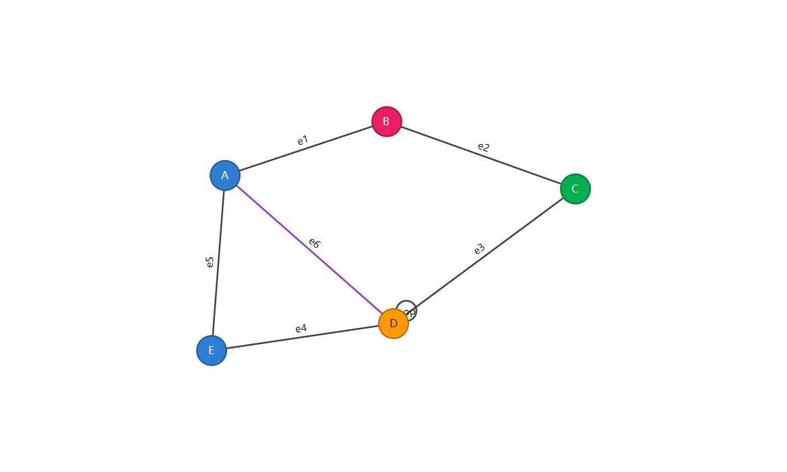

<div align="center">

# GraphEditor

**轻量的 Windows 图论绘图与编辑工具**

画顶点、连边、上色命名，然后导出成 SVG。支持多文档窗口、有向图与多重图。绿色单文件，免安装，不需要 .NET SDK。

[](#build)
[](#build)
[](#build)
[](#)
[](#tests)
[](LICENSE)



</div>

## 目录

- [这是什么](#about)
- [功能](#features)
- [快速开始](#quickstart)
- [操作方式](#controls)
- [从源码构建](#build)
- [测试](#tests)
- [项目结构](#layout)
- [`.graph` 文件格式](#fileformat)
- [常见问题](#faq)
- [关于数字签名](#signing)
- [许可证](#license)

<a id="about"></a>

## 这是什么

GraphEditor 是一个画**图（graph）**的 Windows 桌面工具：顶点、边、自环、多重边，配上名字和颜色，导出成矢量图。

它不追求做成通用图示工具，而是把「画一张图论意义上的图」做扎实：

- 画布是**无限平面**（参考 draw.io），想画多远画多远，不用管理「画布尺寸」；
- 顶点与边各是**一套全局样式**，改一次全体生效，不用逐个调；
- **框选 / 复制 / 剪切 / 粘贴 / 旋转**齐全，批量整理一张图很快；
- 导出 **SVG** 只保留内容的最小外接矩形，直接能贴进论文或课件。

整个程序约 **4,800 行 C#**，零第三方依赖，用 Windows 自带的 `csc.exe` 就能编译出单个 exe。

<a id="features"></a>

## 功能

### 画布

- **无限平面** —— 没有纸张边界，元素可以落在任意坐标（含负坐标）。
- **原点居中** —— 初始时 `(0,0)` 位于客户区正中，`x` 向右、`y` 向下。
- **滚动条按需出现** —— 内容全部可见时不显示，超出时才出现，可滚动范围随内容变化。
- **滚轮缩放** —— 以光标为锚点，10% ~ 800%。

### 顶点与边

| 能力 | 说明 |
| --- | --- |
| 新建顶点 | 空白处右键 →「新建顶点」（落在光标处） |
| 连线 | **在顶点上按住右键拖到另一个顶点**再松开 |
| 自环 / 多重边 | 拖回自身即成自环；同一对顶点间可连多条边（自动弯曲错开） |
| 选中与移动 | 左键点击选中，拖动移动（关联的边自动跟随） |
| 框选 | 空白处左键拖出矩形；**只有两个端点都被框中的边才会被选中** |
| 多选 | `Ctrl` + 左键点击，可混合选择顶点与边 |
| 微调 | 方向键 1 像素，`Shift` + 方向键 10 像素 |

### 图类型

「属性 → 图」里有两个开关，作用于**当前文档**。**默认都是关闭**（无向、单重图）：

| 开关 | 开启时 | 关闭时 |
| --- | --- | --- |
| **多重图** | 同一对顶点之间可以有多条边，也允许自环 | 每对顶点最多一条边；**关闭时会立刻删除多余的重边与自环**，之后也不允许再建 |
| **有向图** | 边在**终点**（连接的终点）画箭头 | 只**隐藏箭头**，边本身保留；单重图上还会把 A→B 与 B→A 合并成一条 |

边的方向由创建时的拖动方向决定：**在 A 上按住右键拖到 B，就是 A → B**（起点 → 终点）。
### 样式

顶点与边是**两组独立的全局样式**：

- **顶点**：颜色、大小、形状（圆形 / 方形）
- **边**：颜色、线宽、线型（实线 / 虚线 / 点线）

同一组内所有元素的大小与样式完全一致；**只有名字和颜色可以逐个不同**（用调色盘或右键菜单单独着色）。

新建文档的默认值：顶点半径 **10**、名字显示在**上方**、**无向单重图**。

> 顶点名字**始终单行显示**：放在「内部」但顶点太小放不下时，会自动改画到顶点上方，
> 保证完整可见（既不换行也不会被裁掉）。

### 命名

命名规则只影响**新建**的元素，不会重命名已有的。

| 规则 | 顶点得到 | 边得到 |
| --- | --- | --- |
| 不命名 | 无名字 | 无名字（**默认**） |
| 字母 | `A` `B` … `Z`，之后 `A1` `B1` …（**顶点默认**） | `a` `b` … `z`，之后 `a1` `b1` … |
| 前缀 + 数字 | `V1` `V2` `V3` … | `e1` `e2` `e3` … |
| 两端点名字 | — | 端点名字拼接，如 `AB`；重名加数字后缀 |

名字显示位置也可配置：顶点可选 内部 / 上方 / 下方 / 左侧 / 右侧，边可选 内部 / 上方 / 下方。

### 编辑

- **复制 / 剪切 / 粘贴** —— 范围是选中顶点集**诱导的子图**：选中的顶点，加上两端点都被选中的边。剪切时还会额外删除所有与选中顶点相连的边。
- **旋转** —— 把选中的顶点绕其几何中心旋转（任意角度，或 45° / 90° 等预设）。
- **删除** —— `Delete`，或右键菜单。

### 文件

| 格式 | 说明 |
| --- | --- |
| `.graph` | 自己的 JSON 格式，读回后样式、名字、颜色全部还原 |
| `.svg` | 矢量导出，只包含内容的最小外接矩形（外加 12 像素留白） |

内置容错：悬空边（引用了不存在的顶点）会被丢弃，非法颜色会被忽略，缺失字段用默认值补齐。

<a id="quickstart"></a>

## 快速开始

### 下载即用

1. 到 [Releases](https://github.com/I0me0I/GraphEditor/releases) 下载 `GraphEditor.exe`；
2. 双击运行（首次会有 SmartScreen 提示，见[关于数字签名](#signing)）；
3. 无需安装，无需 .NET SDK。

> 想让 `.graph` 文件双击默认用它打开：运行 `tools\register-filetype.ps1`（只写当前用户注册表，不需要管理员权限）。

### 五分钟上手

1. 空白处**右键 →「新建顶点」**，连点几下摆出几个点；
2. 在顶点上**按住右键拖到另一个顶点**，松开即成一条边；
3. **左键拖动**顶点调整位置，边会跟着走；
4. **滚轮**缩放，**空白处右键拖动**平移画布；
5. 想批量操作就**左键框选**，再用右键菜单复制 / 旋转 / 改色；
6. `文件 →「导出为 SVG」` 拿到矢量图。

<div align="center">

</div>

<a id="controls"></a>

## 系统集成

- **高 DPI 感知（PerMonitorV2）**：在 125% / 150% / 200% 缩放下按真实像素渲染，文字清晰不发虚；
  多个不同缩放的显示器之间拖动窗口也会自动重新布局。程序内嵌了 manifest 并声明了
  `PerMonitorV2`，同时 `GraphEditor.exe.config` 里开启了 WinForms 的对应开关。
- **系统默认窗口样式**：不自绘标题栏、不改 DWM 属性，圆角/边框/标题栏颜色全部交给 Windows；
  换成系统深色主题或不同 Windows 版本时，外观自动跟随（和 7-Zip 这类经典程序一致）。
  这些调用会静默跳过，不影响运行。
## 多文档

多个文档以**标签页**共存（类似记事本 / Edge / VSCode），标签页铺满工作区，不使用层叠窗口：

- `文件 → 新建` / `打开` 会新开一个标签页，而不是替换当前图。
- 每个文档有**自己的工作区、文件路径与修改状态**，互不影响（包括样式设置与图类型）。
- 每个面板都是**原生 `TabControl`**，边框、标签、滚动条全部由系统绘制。
- 界面元素一律使用 WinForms 默认外观：不设置自定义颜色、不使用自绘控件、不改系统主题。
- 所有菜单（编辑、视图、属性）只作用于**当前活动标签页**。
- **拖动标签页到面板边缘**即可拆分那个面板：拖到左/右边 → 左右并排，拖到上/下边 → 上下分栏。
- 拆分规则固定两层：**整个工作区先拆成左右（或上下）2 份**，每份可以整块使用，
  也可以再拆成 2 份 —— 最多 **4 个面板**，不会出现「左边 3 段、右边 1 段」这种失衡。
- 拖到面板**中间**则把标签移进那个面板；面板里的文档被移空/关空时会自动收掉，不会留下空白。
- 拖动时使用**系统默认光标**，到达可贴靠位置时用系统的**可逆虚线框**（和资源管理器拖动一样）
  框出即将占用的那一半区域（左/右/上/下各自对应正确的一半）；不能放置时显示系统禁止光标，按 `Esc` 可取消。
- 把文档拖回原来的半边会**自动收拢**回单栏，不会留下空白的半块区域。
- `窗口` 菜单提供左右分栏 / 上下分栏 / 合并为单栏，以及文档切换与关闭（`Ctrl+W`）。
- 合并回单栏：**双击某条分割条只合并它两侧的面板**（第一层就是全部）；
  也可以 `窗口 → 合并为单栏` 一次全部合并。
- 拖到另一个面板的**标签条或中间** → 标签并入那个面板；拖到**内容区边缘** → 拆分。
- 关闭文档或退出程序时，若有未保存修改会逐个询问。
## 操作方式

### 视图

| 操作 | 方式 |
| --- | --- |
| 缩放 | 鼠标滚轮（以光标为锚点，10% ~ 800%） |
| 平移 | 在空白处或边上**按住右键拖动**（起手延迟仅 50ms） |
| 适应窗口 | 视图菜单，或 `Ctrl+9` |
| 实际大小 | 视图菜单，或 `Ctrl+1` |
| 回到原点 | 视图菜单「回到原点」 |
| 居中显示内容 | 视图菜单「居中显示内容」（打开文件时自动执行一次） |

### 鼠标

| 手势 | 行为 |
| --- | --- |
| 左键点击 | 选中顶点 / 边 |
| `Ctrl` + 左键点击 | 加选 / 减选 |
| 左键拖动 | 空白处为框选；顶点上为移动 |
| **顶点上右键拖动** | 拉出连线 |
| **空白处 / 边上右键拖动** | 平移画布 |
| 空白处右键**点击**（未拖动） | 弹出右键菜单（按住多久都算，长按不动也算） |
| 右键 →「颜色」 | 调色盘；最后一项「默认颜色」可清除单独着色，恢复跟随全局 |
| 滚轮 | 缩放 |

> 右键手势刻意对齐 draw.io：**右键拖动就是平移**。为避免「按下瞬间的手抖被当成拖动」，
> 加了 50ms 的起手延迟；延迟内松手、或延迟过后始终没有移动，抬手都弹菜单。

### 键盘

| 快捷键 | 功能 |
| --- | --- |
| `Ctrl+N` / `Ctrl+O` / `Ctrl+S` | 新建 / 打开 / 保存 |
| `Ctrl+Z` | 撤销 |
| `Ctrl+A` | 全选 |
| `Ctrl+C` / `Ctrl+X` / `Ctrl+V` | 复制 / 剪切 / 粘贴 |
| `Ctrl+W` | 关闭当前文档 |
| `Delete` | 删除选中元素 |
| `Esc` | 取消选择 |
| 方向键 / `Shift`+方向键 | 微调 1 / 10 像素 |

### 菜单栏

- **文件** —— 新建、打开、保存、另存为、导出为 SVG、退出
- **编辑** —— 撤销、全选、取消选择、复制、剪切、粘贴、删除
- **视图** —— 放大、缩小、实际大小、适应窗口、重置视图、回到原点、居中显示内容
- **属性** —— **顶点**（颜色 / 大小 / 形状 / 默认命名 / 名字位置）、**边**（颜色 / 线宽 / 线型 / 默认命名 / 名字位置）、**图**（多重图 / 有向图）
- **窗口** —— 左右分栏、上下分栏、合并为单栏、关闭当前文档、文档切换列表
- **帮助** —— 使用说明、关于

<a id="build"></a>

## 从源码构建

### 系统要求

| 项 | 要求 |
| --- | --- |
| 操作系统 | Windows 7 SP1 及以上（已在 Windows 10 / 11 验证） |
| 运行时 | .NET Framework 4.8（Windows 10 1903+ / Windows 11 自带） |
| 编译 | 系统自带的 `C:\Windows\Microsoft.NET\Framework64\v4.0.30319\csc.exe` |
| 开发环境 | **不需要** Visual Studio，也**不需要** .NET SDK |

### 构建

```powershell
git clone https://github.com/I0me0I/GraphEditor.git
cd GraphEditor
powershell -NoProfile -ExecutionPolicy Bypass -File build.ps1
```

产物：`build\GraphEditor.exe`（约 470 KB 单文件）。

脚本会自动定位 `csc.exe`、把 `assets\GraphEditor.ico` 嵌进 exe，并把 `README.md`、`demand.md`、`docs\` 复制到 `build\`。

<details>
<summary>改用 Visual Studio 编译</summary>

把 `src\GraphEditor\*.cs` 加入一个「Windows 窗体应用 (.NET Framework)」项目，目标框架选 **.NET Framework 4.8** 即可。

注意源码只用了 **C# 5** 语法（没有字符串内插、没有 `nameof`、没有 `?.`），因为系统自带的 csc 版本较老。想放宽可自行提高语言版本。

</details>

<a id="tests"></a>

## 测试

项目自带一个**不依赖任何测试框架**的自检程序，共 **659 项断言**，覆盖模型、几何、序列化、SVG 导出、滚动与命中测试，以及真实的 UI 交互路径。

```powershell
# 全部
powershell -NoProfile -ExecutionPolicy Bypass -File tests\run-tests.ps1

# 只跑某个用例
powershell -NoProfile -ExecutionPolicy Bypass -File tests\run-tests.ps1 -Only TestPanGestures
```

输出：

```
================ 自检结果 ================
通过: 659    失败: 0
产物目录: ...\artifacts
========================================
RESULT passed=659 failed=0
```

### 什么时候该跑测试

改动规模决定测试成本，不做无谓重复：

| 改动性质 | 构建 | 跑测试 | 新增断言 |
| --- | --- | --- | --- |
| 视觉微调（颜色 / 间距 / 字号 / 边框样式） | ✅ | ❌ 截图确认即可 | ❌ |
| 注释、文档、文案 | ❌ | ❌ | ❌ |
| Bug 修复 | ✅ | ✅ | 视情况（复发风险高才加） |
| 功能添加 / 行为变更 | ✅ | ✅ | ✅ |
| 小版本 / 大版本发布 | ✅ | ✅ 全量 | — |

不要把颜色、坐标这类**实现细节**写进断言 —— 这类测试会在合法的视觉调整时误报，反而碍事。
要防复发，优先在代码里写清「为什么不能这么写」。

自检会真实构造 `MainForm`、模拟鼠标按下 / 移动 / 抬起（包括带真实定时器等待的用例），因此验证的是**用户实际会走的代码路径**，而不只是纯函数。

<a id="layout"></a>

## 项目结构

```
GraphEditor/
├─ src/GraphEditor/            应用源码（约 4,800 行 C#）
│  ├─ Program.cs               入口、命令行开关
│  ├─ MainForm.cs              主窗口：菜单栏、状态栏、文档管理
│  ├─ DocumentArea.cs          标签页容器：多文档切换、拖动标签分栏
│  ├─ DocumentView.cs          单个文档：工作区、文件路径与修改状态
│  ├─ CanvasControl.cs         工作区：绘制、缩放、滚动条、全部鼠标键盘交互
│  ├─ GraphModel.cs            模型：顶点、边、画布全局样式、几何与命中测试
│  ├─ GraphIo.cs               .graph 读写（自带 JSON 读写器，无第三方库）
│  ├─ SvgExport.cs             SVG 导出
│  ├─ Dialogs.cs               输入对话框、调色盘控件
│  └─ AssemblyInfo.cs          版本信息
├─ tests/
│  ├─ TestRunner.cs            659 项断言的自检程序
│  └─ run-tests.ps1            编译并运行自检
├─ tools/
│  ├─ make-icon.ps1            从零生成应用图标（7 个尺寸的 DIB 帧）
│  └─ register-filetype.ps1    注册 / 取消 .graph 文件关联（HKCU）
├─ assets/GraphEditor.ico      应用图标
├─ docs/
│  ├─ images/                  README 截图
│  └─ TROUBLESHOOTING.md       详细说明：实现要点、诊断开关、排错
├─ build.ps1                   构建脚本
├─ demand.md                   最初的完整需求说明
└─ LICENSE                     MIT
```

<a id="fileformat"></a>

## `.graph` 文件格式

就是一个 UTF-8 的 JSON 文本，可以手改，也可以进版本控制。

```jsonc
{
  "format": "GraphEditor.Graph",
  "version": "1.0",
  "vertexStyle": {
    "radius": 18,
    "shape": "circle",                          // circle | square
    "defaultColor": "#2D7DD2",
    "naming": "alphabetic",                     // none | alphabetic | numeric
    "labelPlacement": "inside"                  // inside | above | below | left | right
  },
  "edgeStyle": {
    "width": 2,
    "lineStyle": "solid",                       // solid | dashed | dotted
    "defaultColor": "#404040",
    "naming": "none",                           // none | alphabetic | numeric | fromEndpoints
    "labelPlacement": "above"                   // inside | above | below
  },
  "vertices": [
    { "id": 1, "x": 380, "y": 200, "name": "A", "color": null }
  ],
  "edges": [
    { "id": 1, "v1": 1, "v2": 2, "name": "e1", "color": null }
  ],
  "graph": {
    "multi": false,       // 多重图：允许重边与自环（默认 false = 单重图）
    "directed": false     // 有向图：边在终点画箭头（默认 false = 无向）
  }
}
```

- `color` 为 `null` 表示跟随全局默认色。
- 坐标是**图像坐标**：原点 `(0,0)`，`x` 向右、`y` 向下。因为画布是无限平面，
  坐标可以是负数、也可以很大；加载时**不会**被钳制到任何矩形内。
- 文件里**没有**画布尺寸字段。早期版本写过 `canvas.width/height`，现在读取时直接忽略。
- 加载时容错：悬空边丢弃、非法颜色忽略、缺失字段用默认值补齐。

<a id="faq"></a>

## 常见问题

<details>
<summary><b>首次运行弹出「Windows 已保护你的电脑」怎么办？</b></summary>

点弹窗里的 **「更多信息」** → 右下角出现 **「仍要运行」** → 点它即可，Windows 会记住这个选择。

原因见[关于数字签名](#signing)。

</details>

<details>
<summary><b>提示「无法加载文件 … 因为在此系统上禁止运行脚本」</b></summary>

系统的 PowerShell 执行策略是 Restricted。按本文档的方式调用即可（只对本次进程放开策略）：

```powershell
powershell -NoProfile -ExecutionPolicy Bypass -File build.ps1
```

不必为了跑脚本把全局执行策略改成 `Unrestricted`。

</details>

<details>
<summary><b>界面的外观是怎么定的？</b></summary>

**完全使用 WinForms / Windows 默认外观，没有任何自绘。**

- 窗口、标题栏、圆角、边框：交给 Windows（不调用 DWM，不设自定义颜色）
- 菜单栏、状态栏、右键菜单、对话框：`MenuStrip` / `StatusStrip` / `ContextMenuStrip` / `MessageBox` 原样使用
- 标签页与面板：原生 `TabControl`
- 滚动条：原生 `VScrollBar` / `HScrollBar`
- 拖动反馈：系统光标 + 一个半透明置顶小窗口标出落点
- 字体：`SystemFonts.MessageBoxFont`，随系统语言与 DPI 自动匹配

以 [7-Zip](https://www.7-zip.org/) 为参考：只用系统控件，不追求自定义视觉。

> 早期版本曾经自绘标签条和 3D 边框，会出现「Win11 圆角窗口 + Win95 3D 边框 + 自绘扁平标签」三种风格打架的问题，
> 现已全部移除。**代价**是标签与空白处的对比度只能由系统主题决定，无法像自绘时那样精确控制。

</details>

<details>
<summary><b>双击 <code>.graph</code> 文件没有用它打开</b></summary>

先运行一次文件关联注册（只写当前用户，不需管理员）：

```powershell
powershell -NoProfile -ExecutionPolicy Bypass -File tools\register-filetype.ps1
```

若图标没立刻刷新，注销再登录一次，或在「默认应用」里手动指定。

</details>

<details>
<summary><b>怎么确认下载的 exe 没被篡改？</b></summary>

Release 说明里会给出 SHA-256，本地核对：

```powershell
Get-FileHash .\GraphEditor.exe -Algorithm SHA256
```

在没有数字签名的阶段，这是最实用的替代方案。

</details>

<details>
<summary><b>遇到滚动 / 视图异常，怎么抓现场信息？</b></summary>

程序内置了几个只用于排查的启动参数（正常使用不需要）：

| 参数 | 作用 |
| --- | --- |
| `/diag` | 状态栏右下角实时显示视图原点、滚动条位置、可滚动上限、缩放 |
| `/diaglog:路径` | 每 120ms 把上述状态追加写入指定文件 |
| `/dump:路径` | 启动后把滚动映射写成文本文件 |
| `/open:路径` | 直接打开指定的 `.graph` 文件 |

```powershell
.\build\GraphEditor.exe /diag
```

`/diag` 模式下按 **F12** 会把当前视图状态写入程序目录的 `scroll-state.txt`
（含缩放、视口尺寸、视图原点、滚动条位置、以及视口上下边对应的坐标）。

更多实现细节与排错见 [`docs/TROUBLESHOOTING.md`](docs/TROUBLESHOOTING.md)。

</details>

<a id="signing"></a>

## 关于数字签名

**先说结论：这个程序没有数字签名，所以 Windows SmartScreen 会拦一下。** 这是预期行为，不是程序有问题 —— 首次运行点「更多信息」→「仍要运行」即可。

之所以没签名，是因为让公开发布的程序获得**有效的**签名要花钱，而且有个容易被忽略的坑。

### 自签名证书解决不了问题

可以自己生成证书来签名（`New-SelfSignedCertificate`），但**对别人毫无用处** —— 那个证书的根不在任何一台 Windows 的受信任根列表里，别人拿到后警告不会变少，甚至可能提示「证书不受信任」。自签名只适合在自己机器上做测试。

### 真正要消除 SmartScreen 警告，只有两条路

| 方案 | 费用 | 效果 |
| --- | --- | --- |
| **EV 代码签名证书**（扩展验证） | 约 ¥2000–5000 / 年 | 立刻获得 SmartScreen 信誉，**新证书也直接不报** |
| **OV 代码签名证书**（标准） | 约 ¥1000–3000 / 年 | 仍需**累积下载量**建立信誉，新证书前期照样报警告，几周到几个月后逐渐消失 |

无论哪种，**2023 年 6 月起私钥必须存放在硬件令牌或云 HSM 中**（CA/Browser Forum 新规），不能再是硬盘上的 `.pfx` 文件。主流选择：

- **DigiCert / Sectigo / GlobalSign** —— 传统 CA，提供硬件 USB Token 或云签名服务；
- **Azure Trusted Signing**（微软自家，原 Azure Code Signing）—— 约 $9.9/月起，云 HSM，对个人开发者最省事，但**目前个人身份申请仍受限**，通常需要企业实体。

### 免费的可能途径

如果这是开源项目，可以试试：

- **[SignPath.io](https://signpath.io/)** —— 为开源项目提供免费代码签名（需申请审核）；
- **[Certum](https://certum.eu/)** —— 面向开源项目的低价证书。

这两者给的通常是 **OV 级别**，也就是说**仍然需要时间积累信誉**，只是不用自己掏钱。

### 有了证书之后怎么签

用 Windows SDK 里的 `signtool.exe`（需装 [Windows SDK](https://developer.microsoft.com/windows/downloads/windows-sdk/)，或只装其中的签名工具）。

```powershell
# 时间戳很关键：没有它，证书过期后已签名的文件会立刻失效
signtool sign `
  /fd SHA256 `
  /tr http://timestamp.digicert.com `
  /td SHA256 `
  /a `
  build\GraphEditor.exe

# 验证
signtool verify /pa /v build\GraphEditor.exe
```

若用云签名服务（Azure Trusted Signing / DigiCert KeyLocker），把 `sign` 换成对应的 `dlib` / `ks` 参数即可，CA 文档里都有现成命令。

<a id="license"></a>

## 许可证

[MIT](LICENSE) © 2026 I0me0I —— 可自由使用、修改、商用，只需保留版权声明。
